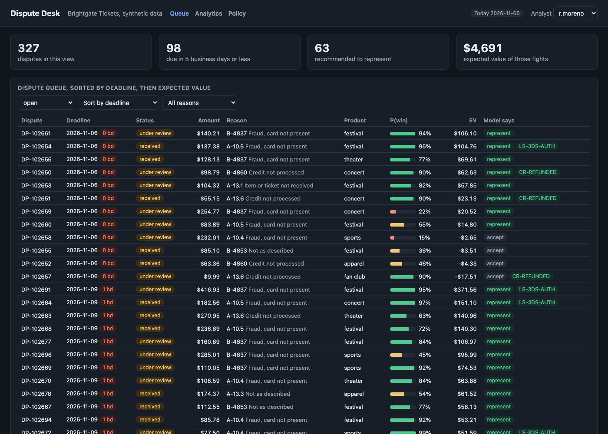
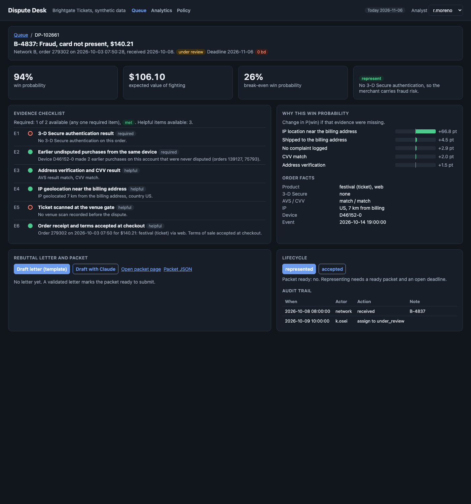

# Dispute Desk

Chargeback and dispute operations for Brightgate Tickets, a made-up online seller of event tickets, merchandise, and a fan club membership. A year of synthetic orders (300,693 card transactions) produces 2,976 disputes across six reason categories and two fictional card networks. Each dispute runs through a lifecycle state machine with network deadlines counted in business days. A calibrated gradient boosting model estimates the chance of winning from the evidence that exists, and the desk fights only when the expected value is positive. For every dispute it fights, it gathers the evidence from the order data, builds a packet, and drafts a rebuttal letter whose citations are checked against that evidence. Prevention analytics show where disputes come from, what 3-D Secure would prevent, and when the merchant is about to breach the network's dispute-rate threshold.



## Results

Held-out disputes received from 2026-08-01 to 2026-11-06 (n = 1,088). The model never saw these months during training or calibration. Each dispute has a known true outcome if represented, so every policy is scored on the same disputes. Costs: $25 handling per representment, $15 extra fee per lost one.

| Policy | Represented | Won | Win rate | Recovered | Handling + fees | Net recovered | vs fight everything |
|---|---:|---:|---:|---:|---:|---:|---:|
| Represent every dispute | 1,088 | 552 | 50.7% | $69,486 | $35,240 | **$34,246** | +0 |
| Accept every dispute | 0 | 0 | 0.0% | $0 | $0 | **$0** | -34,246 |
| Represent when the amount is $75 or more | 579 | 333 | 57.5% | $59,991 | $18,165 | **$41,826** | +7,581 |
| Represent when the key document exists and the amount is $40 or more | 423 | 332 | 78.5% | $49,608 | $11,940 | **$37,668** | +3,422 |
| **Model: represent when expected value is positive** | 594 | 418 | 70.4% | $62,943 | $17,490 | **$45,453** | **+11,207** |
| Hindsight: represent only the disputes that win | 552 | 552 | 100.0% | $69,486 | $13,800 | **$55,686** | +21,440 |

The model policy recovers 33% more net dollars than fighting everything while submitting 45% fewer packets, and captures 82% of what perfect hindsight would. CI fails the build if the model policy stops beating fight-everything.

Model on the same test months: AUC 0.860, Brier 0.150, expected calibration error 1.8% (3.6% before Platt calibration). Calibration by quintile: predicted 9%, 26%, 53%, 79%, 92% against observed 8%, 22%, 55%, 79%, 89%.

Other findings from the run:

- **Monitoring.** The monthly dispute rate (disputes over the prior month's sales) sits near 1.0% most of the year, crosses the 1.10% early warning line in March (1.12%) and September (1.13%), and breaches the 1.25% threshold in October at 1.63%, driven by a wave of festival ticket disputes.
- **3-D Secure.** Challenging every order of $200 or more (15,036 orders a year that are not already authenticated) prevents 13% of fraud disputes and nets $40,688 after the margin lost to checkout abandonment. Challenging everything prevents 64% but nets less ($35,449), because 3.5% of good customers abandon.
- **Friendly fraud.** 76 customers filed two or more disputes (5.2% of all disputes). 37% of those disputes had a venue scan or a delivery confirmation before they were filed.
- **By reason.** Fighting every "canceled recurring" and "item not received" dispute loses money ($2,525 and $1,113 on the test months). The model fights none of the 77 and 51 of the 199.



## Why

Every dispute already took the money back from the merchant. Fighting one costs analyst time and a fee if it is lost, and each card network has strict response windows. Most merchants either fight everything (and spend more on hopeless cases than they recover) or fight nothing (and teach repeat disputers that it works). The real decision is per dispute: how likely is a win given the evidence on file, is the amount worth it, and can the packet be built before the deadline. Networks also watch the merchant's dispute rate, and crossing their threshold brings fines and monitoring programs, so prevention matters as much as recovery. This repo is a small working version of that back office.

## Architecture

```
 generator (seeded)              features (as of dispute date)       win model                       FastAPI + plain JS UI
 ┌──────────────────────────┐    ┌───────────────────────────┐    ┌──────────────────────────┐    ┌─────────────────────────────┐
 │ 300k orders: device, IP, │    │ 25 evidence availability  │    │ HistGradientBoosting     │    │ queue by deadline and EV    │
 │ AVS/CVV, 3-D Secure,     │──▶ │ features: venue scan,     │──▶ │ time split train / calib │──▶ │ detail: checklist, P(win),  │
 │ tracking, venue scans,   │    │ delivery, prior device    │    │ / test, Platt calibrated │    │ reasons, packet, letter     │
 │ refunds, CS contacts     │    │ purchases, CS log, 3DS... │    └────────────┬─────────────┘    │ lifecycle transitions       │
 │ ~3k disputes, hidden     │    └───────────────────────────┘                 ▼                  │ audit trail, sweep job      │
 │ evidence model           │                                     liability shift rules         │ analytics, policy, /metrics │
 └──────────────────────────┘                                     EV = p x amount - cost        └─────────────────────────────┘
              │                                                   policy comparison + CI gate               SQLite (WAL)
              ▼
 prevention analytics: rates by product, channel, reason; 3-D Secure thresholds; repeat disputers; monthly monitor
```

| Piece | File | What it does |
|---|---|---|
| Reason codes | `src/disputedesk/codes.py` | Six categories, 13 fictional network codes mapped to them, deadlines, costs, thresholds |
| Business days | `bizdays.py` | Federal Reserve holidays by rule, weekend observance, add and count business days |
| Lifecycle | `lifecycle.py` | States, legal transitions, guards (packet ready, deadline open), sweep for reminders, auto-accept, issuer timeouts |
| Liability shift | `liability.py` | 3-D Secure authenticated or attempted fraud, and refund-before-dispute, as explicit rules that floor P(win) |
| Data | `generator.py` | Seeded orders and disputes: stolen cards, friendly fraud, real fulfillment failures, gateway retries, missed refunds, charges after cancel |
| Features | `features.py` | Evidence availability as of the dispute date, so nothing from the future leaks in |
| Model | `model.py` | Gradient boosting, time split, Platt calibration, ECE, ablation reasons per dispute |
| Decision | `decision.py` | EV, break-even probability, the five policies and the hindsight bound |
| Evidence | `evidence.py` | Required and helpful evidence per reason, fact gathering, packet JSON and HTML |
| Letters | `letter.py` | Template (default, offline) and Claude providers, citation validator |
| Analytics | `analytics.py` | Dispute rates, 3-D Secure threshold tradeoff, repeat disputers, monthly monitor with trend projection |
| Service | `app.py`, `store.py` | FastAPI, SQLite with an append-only audit table (triggers block UPDATE and DELETE) |

**Lifecycle.** `received` and `under_review` share the merchant's 20 business day response window. `represented` starts the issuer's 30 business day clock; if the issuer lets it run out, the sweep marks the dispute won. `pre_arbitration` gives the merchant 10 business days. Representing requires a ready packet and an open deadline. The daily sweep (`POST /api/sweep`) sends reminders at 5 and 2 business days left, accepts disputes whose expected value is negative, and accepts any dispute that cannot be answered in time rather than letting it lapse.

**Liability shift.** A fraud dispute on a 3-D Secure authenticated order shifts liability to the issuer. That rule is code, not something the model must relearn each retrain: it floors P(win) at 0.95 (0.85 when 3-D Secure was attempted). The floor feeds the same EV calculation, so a $9.99 authenticated dispute is still accepted because the fight costs more than it can recover. The rule also says explicitly that 3-D Secure does not cover other reason categories.

**Evidence and letters.** Each category has a template: a fraud dispute needs a 3-D Secure result or two or more earlier undisputed purchases from the same device; a ticket "not received" dispute needs the venue scan with time and gate; a duplicate dispute needs proof the second charge was its own fulfilled order. The gatherer writes one sentence of fact per item, with ids `E1`, `E2`, and so on. Letters come back as paragraphs that each list the ids they rely on. The validator rejects a letter that cites an id not in the packet, cites a missing item, has a paragraph with no citation, or mentions an id in the text that it does not list. The Claude provider (`claude-opus-5-5`) uses structured output with a JSON schema, is imported lazily, and goes through the same validator. Rejections are written to the audit trail.

**Hidden truth.** The generator knows which orders were stolen-card fraud and each dispute's true win probability. Those columns stay in the database for evaluation, and the API never returns them (a test checks this).

## How to run

```bash
cd dispute-desk
uv sync --python 3.12
uv run disputedesk all --gate        # about 30 seconds: data, model, policies, analytics, store
uv run disputedesk serve --port 8833 # then open http://127.0.0.1:8833
```

Other commands:

```bash
uv run disputedesk policy                                   # print the policy table from the last run
curl -s -X POST localhost:8833/api/sweep -d '{"dry_run": true}' -H 'content-type: application/json'
curl -s "localhost:8833/api/queue?sort=ev&limit=5"
curl -s localhost:8833/metrics | grep dd_
make screenshot                                             # needs the server and Google Chrome
```

The data ends on a fixed date, so the service runs on a fixed clock: `DISPUTEDESK_TODAY` (default 2026-11-06). To try the Claude letter provider, install the extra (`uv sync --extra claude`), set `ANTHROPIC_API_KEY`, and press "Draft with Claude" on a dispute. Everything else works offline.

API: `GET /api/queue`, `GET /api/disputes/{id}`, `/decision`, `/packet`, `/packet.html`, `/audit`, `POST /api/disputes/{id}/letter`, `POST /api/disputes/{id}/transition`, `POST /api/sweep`, `GET /api/analytics`, `/api/policy`, `/api/model`, `/api/reason-codes`, `/healthz`, `/metrics`. Writes take the actor from the `x-analyst` header. Logs are one JSON object per line with a request id.

Docker files (`Dockerfile`, `docker-compose.yml` with a one-shot pipeline job and the API) are built and smoke tested in CI. Docker is not needed to run locally.

## Tests

143 tests, about 30 seconds: `uv run pytest -q`.

- Business days: weekends, Thanksgiving, Saturday and Sunday holiday observance, a 20 day deadline across two holidays, add and count round trips.
- Lifecycle: every legal transition and every illegal one (parametrized over all state pairs), packet and deadline guards, issuer and pre-arbitration clocks, every sweep outcome.
- Liability shift: each rule, non-fraud categories, the probability floor, and a shift that still should not be fought.
- Evidence: gathering per reason category, scan and delivery dated after the dispute not counting, completeness rules, HTML escaping.
- Letters: template letters pass, the validator catches unknown ids, missing evidence, uncited paragraphs, and inline ids not listed; the Claude provider against a fake client (structured output, rejection, bad JSON, refusal); lazy import.
- EV and policies: the EV formula, break-even, net recovered dollars, and the policy comparison on a four-dispute dataset with hand-computed answers.
- Model: time split ordered and disjoint, no leakage (features unchanged when the data after a cutoff is removed), no hidden-truth columns, calibration and AUC bounds, ablation reasons pointing the right way, the policy gate.
- Monitoring: prior-month denominator, warning, breach, and trend-projection warnings.
- API end to end: queue ordering and filters, detail without hidden fields, packet JSON and HTML, letter then represent with audit entries, 409 on illegal moves, a fake Claude client whose letter is rejected, sweep dry run and apply, append-only audit, metrics format.

CI (`.github/workflows/ci.yml`): ruff and pytest, a policy gate job that runs the full pipeline and fails unless the model policy beats fight-everything, and a Docker job that builds the image, runs the pipeline in a container, and smoke tests the API.

## Production notes

- **Real networks.** Each network has its own reason codes, evidence rules, and portal or API for submission. The mapping table and templates would become versioned config per network, and submission would go through the acquirer's dispute API with retries and receipts stored with the audit trail.
- **Labels.** Here every dispute has a known outcome if fought. In production you only see outcomes for disputes you fought, so the model needs a small random exploration share of fights (or inverse propensity weighting) to keep learning about the ones it would accept.
- **Store and queue.** SQLite becomes Postgres, the sweep becomes a scheduled job with a lock so it runs once, and reminders go to the case tool and email. The audit table would be append-only at the database permission level, not only by trigger.
- **Model governance.** Retrain monthly on a rolling window, monitor calibration and win rate by reason code, and keep the gate in CI so a retrain that loses money compared with fight-everything never ships.
- **Letters.** A person approves every letter before submission. The citation validator stays in the path, and prompt and model versions are stored with each letter.
- **Prevention.** The 3-D Secure threshold would be tested as an A/B experiment on real abandonment instead of an assumed 3.5%.

## License

MIT. See [LICENSE](LICENSE).
